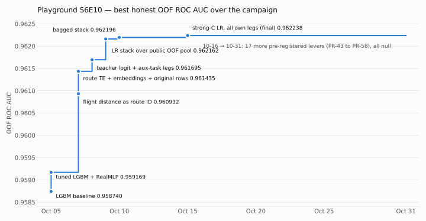

# Playground Series S6E10 — Predicting Airline Satisfaction

Binary classification (ROC AUC) of `satisfaction` from passenger, flight, delay and 0-5 service-rating features.

Kaggle: <https://www.kaggle.com/competitions/playground-series-s6e10> (deadline 2026-10-31)

## Score progression

Each point is a new campaign best on out-of-fold ROC AUC (LB-blind: public leaderboard scores
were never used for decisions). Most of the gain came in the first week: treating
`flight_distance` as a route ID (+0.0018 at the blend), then stacking our legs with the public
OOF library (+0.0005). After 10-15 the score stayed at 0.962238; the 17 levers tried from 10-16
to 10-31 were all null. Regenerate with `python src/plot_progress.py`; the milestones are
transcribed from `CLAUDE.md`.

See `CLAUDE.md` for the dataset, EDA findings, invariants and experiments log.
